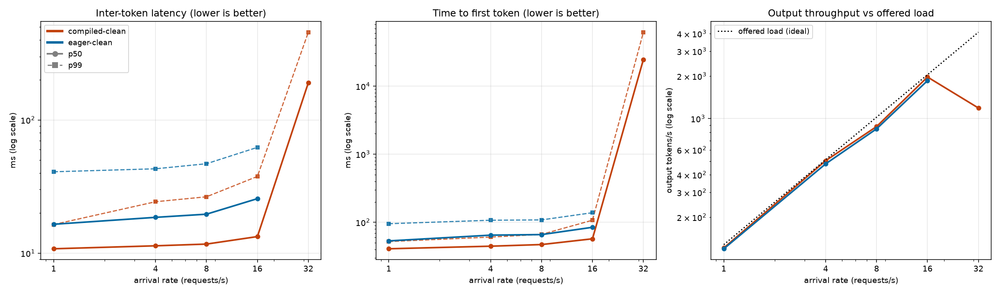

# Inference Lab

Benchmarking and tuning LLM serving on a single consumer GPU. The goal is to measure how compilation, batching,
quantization, and caching change latency, throughput, memory, and quality, and to explain each result from first principles.

**Status:** week 1 of an 8-week project. Results below are for one model (Qwen2.5-3B-Instruct, BF16) in two vLLM
configurations. Quantization, profiling, and a from-scratch scheduler are planned (see Roadmap).

## Result so far: compilation and CUDA graphs vs eager mode



Median inter-token latency (ITL) and time to first token (TTFT), open-loop Poisson arrivals, 128 output tokens per request:

| Arrival rate (req/s) | ITL p50, eager / compiled | TTFT p50, eager / compiled |
|---|---|---|
| 1 | 16.5 / 10.8 ms (1.53x) | 53 / 41 ms |
| 4 | 18.6 / 11.3 ms (1.65x) | 65 / 45 ms |
| 8 | 19.6 / 11.7 ms (1.68x) | 66 / 47 ms |
| 16 | 25.6 / 13.3 ms (1.92x) | 85 / 57 ms |

"Compiled" is vLLM's default mode (torch.compile plus CUDA graphs); "eager" is `--enforce-eager`.
Throughput is only 1 to 6% higher at these rates because the load is open-loop and below saturation, so output tokens/s is
capped by the offered load; latency is the discriminating metric.

### What the numbers say
- **Launch overhead explains about 57% of the single-stream gap.** At 1 req/s, decode runs at ~61 tok/s (eager) and ~93 tok/s
  (compiled), versus a bandwidth-bound ceiling of ~154 tok/s (5.79 GiB of weights at ~960 GB/s peak, an approximate figure).
  Compilation and CUDA graphs remove 5.7 ms of the 10 ms gap. About 4.3 ms is still unexplained and needs profiling.
- **The KV-cache formula predicts vLLM's reported capacity exactly:** `2 x layers x kv_heads x head_dim x bytes` = 36,864 B/token
  for this model, times 207,984 tokens = 7.14 GiB.
- **Overload behaves badly.** At 32 req/s the compiled server delivered 1,189 to 1,309 tok/s, less than the 1,971 tok/s it handled
  at 16 req/s, with multi-second TTFT. In this environment (WSL2) the server then stayed slow at low load (ITL about 50 ms vs
  11 ms) until restarted. It is not KV-cache exhaustion (0 preemptions), not thermal or clock throttling, and not the
  `--gpu-memory-utilization` budget (tested at 0.75). The cause is unknown; see `LAB_LOG.md`.

## Method
- Open-loop Poisson arrivals (the server cannot throttle the load), 30 s per rate with at least 100 requests; p50/p95/p99 reported.
- Each prompt has a unique prefix so vLLM's prefix cache cannot make runs depend on one another.
- Fixed output length (`ignore_eos`, `min_tokens`), temperature 0, `--generation-config vllm` so sampling defaults are identical across configs.
- **Canary checks:** a short rate-1 run before and after each sweep. A sweep is invalid if the after-canary ITL is more than 1.3x the before value.
- Fresh server per configuration; overload runs go last because they leave the server degraded.

## Environment
RTX 5080 (16 GB, sm_120) on Windows with WSL2 (Ubuntu 22.04.5), driver 615.65.07, Python 3.12.15, vLLM 0.31.0, PyTorch 2.13.0+cu132,
FlashAttention 2 backend. Qwen2.5-3B-Instruct in BF16, `--max-model-len 4096`, `--gpu-memory-utilization 0.85`.
Compiled mode also needs `--kernel_config.enable_jit_warmup=False` here because FlashInfer's JIT build fails in this environment.
Absolute numbers will differ on native Linux; the comparison between configurations is the point.

## Reproduce
```bash
./serve_compiled.sh          # or ./serve_eager.sh, in its own terminal; wait for "Application startup complete"
python bench.py --model Qwen/Qwen2.5-3B-Instruct --rates 1,4,8,16 --label compiled-clean --out results/main.csv
python plot.py --labels eager-clean compiled-clean --out results/eager_vs_compiled_clean.png
```

## Files
- `bench.py`: open-loop load generator for OpenAI-compatible `/v1/completions` endpoints (TTFT, ITL, TPOT, throughput, optional $/M tokens)
- `plot.py`: latency and throughput plots from the results CSV
- `serve_compiled.sh`, `serve_eager.sh`: exact server launch commands used
- `results/`: raw CSVs and server logs
- `LAB_LOG.md`: running log of setup, failures, hypotheses (including ones that were refuted), and decisions

## Data validity in `results/main.csv`
| Label | Status |
|---|---|
| `eager-clean`, `compiled-clean` | Valid (unique prompts, fresh server, canaries passed for rates 1 to 16) |
| `eager-bf16-3b`, `compiled-bf16-3b` | Pilot: harness reused identical prompts across runs (prefix cache contaminated); compiled rates 1 to 16 reproduce within ~7% (p50 ITL) |
| `compiled-bf16-3b-r2` | Unreliable: rate 32 run on a server that may already have been degraded |
| `compiled-v2` | Invalid: run on a degraded server |

`results/eager_v0_100req.csv` is from an earlier harness version (fixed 100 requests per rate) and is kept as a record.

## Roadmap
1. Hugging Face `generate` vs vLLM baseline
2. Quantization on an 8B model (FP8, INT4, NVFP4): memory, speed, perplexity
3. Prefix caching, chunked prefill, speculative decoding; `--max-num-seqs` sweep
4. Profiling and roofline analysis; explain the remaining gap and the overload behavior
5. A small continuous-batching scheduler with a paged KV cache, compared against vLLM
