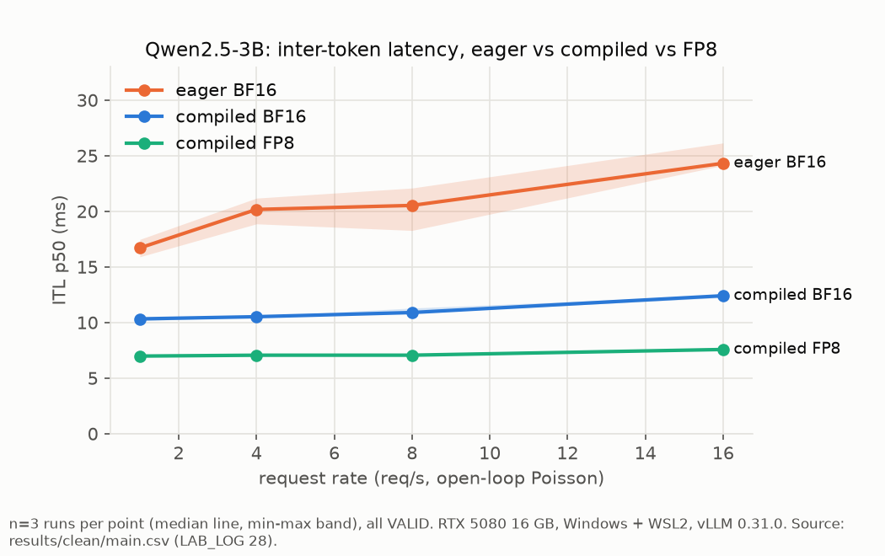
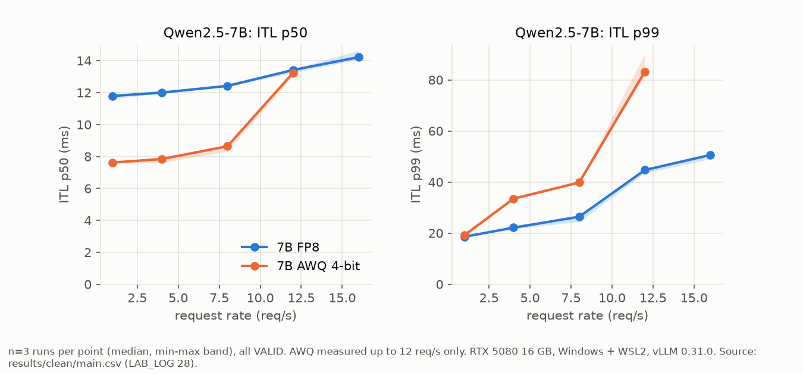
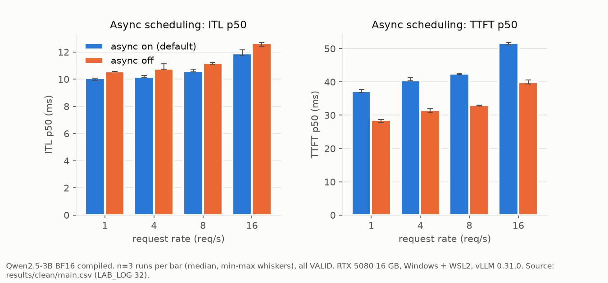
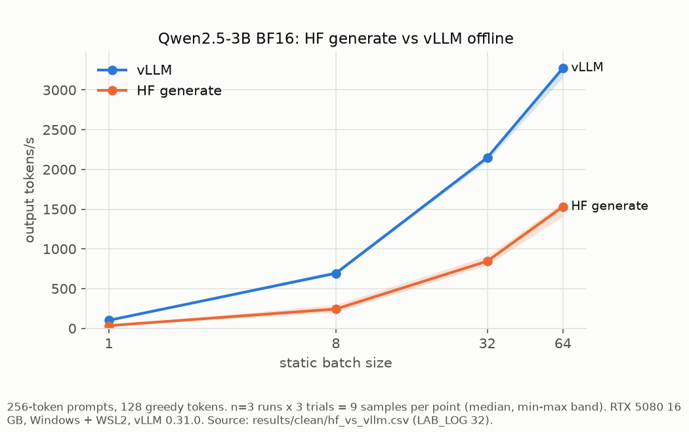
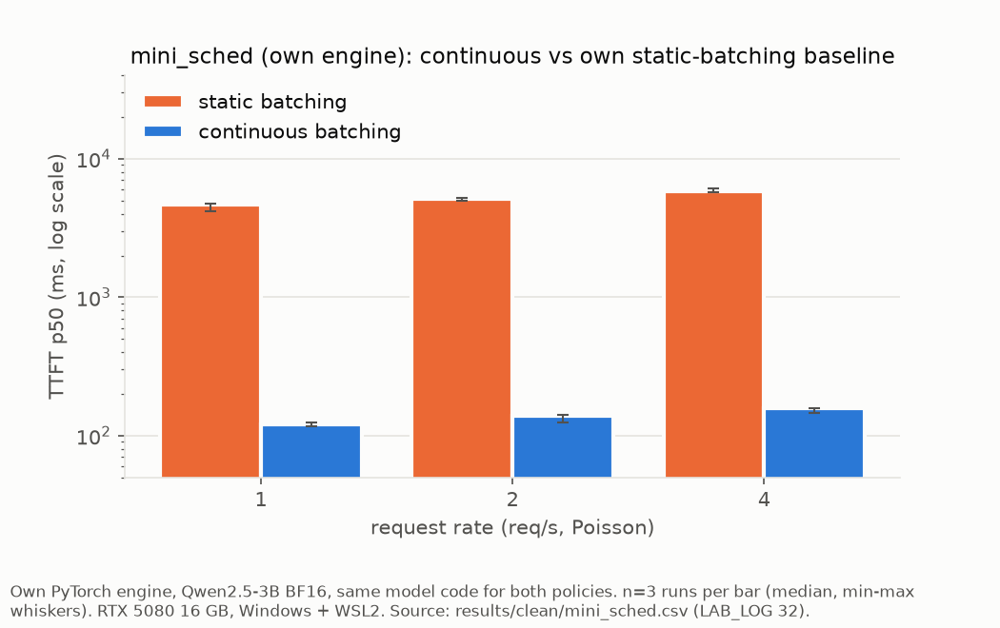
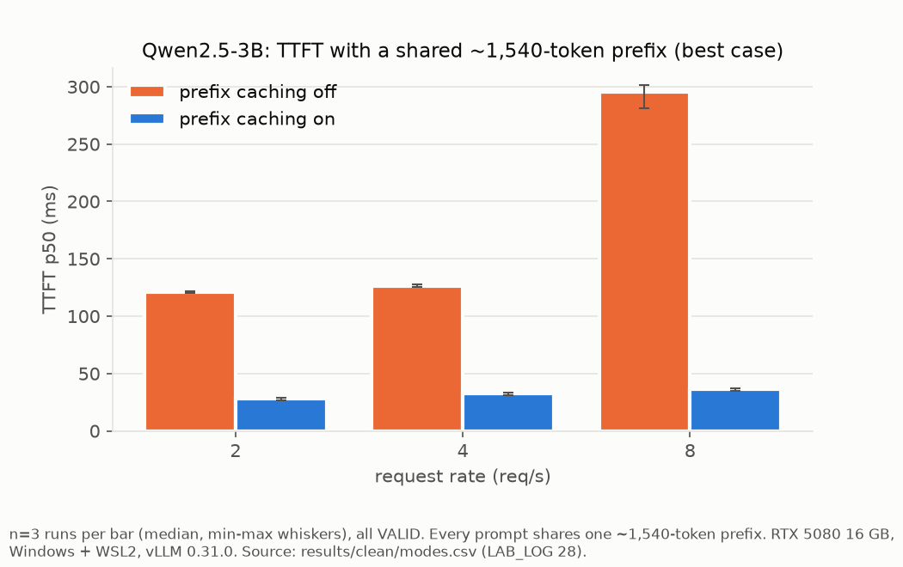

# Inference Lab

Benchmarking LLM serving on a single consumer GPU (RTX 5080, 16 GB, WSL2): how compilation, quantization, caching, scheduling,
batching policy and speculative decoding change latency and throughput, measured with a harness that refuses to run on a busy GPU
and rejects runs where the server degraded. Plus a small continuous-batching engine with a paged KV cache written from scratch
(`mini_sched/`).

Every timing number below comes from the clean reruns of 2026-10-10/11 (`results/clean/`, LAB_LOG sections 28, 32 and 33);
perplexities come from VALID runs in `results/ppl.csv` and `results/clean/ppl.csv` (LAB_LOG 34). Values are
**median [min-max] over n runs**; ratios are ratios of medians, **truncated, never rounded up**. Full tables:
`results/clean/summary_20261011_093900.md`. `LAB_LOG.md` has the complete record, including failed attempts, refuted hypotheses
and invalid runs. Hardware for everything: RTX 5080 16 GB, Windows + WSL2, vLLM 0.31.0 (details under Environment).

## Results

### Compilation and CUDA graphs vs eager (Qwen2.5-3B BF16, n=3 interleaved runs per arm; LAB_LOG 28)


| Rate (req/s) | ITL p50 eager (ms) | ITL p50 compiled (ms) | eager / compiled |
|---|---|---|---|
| 1 | 16.70 [15.90-17.46] | 10.32 [10.15-10.35] | 1.61x |
| 4 | 20.16 [18.86-21.18] | 10.51 [10.49-10.54] | 1.91x |
| 8 | 20.52 [18.27-22.08] | 10.89 [10.85-11.29] | 1.88x |
| 16 | 24.31 [24.12-26.14] | 12.40 [12.23-12.45] | 1.95x |

Compiled ITL p50 is 1.6x to 1.9x lower and TTFT p50 33.0% to 39.0% lower (rates 1 to 16, n=3). All three arms use the same serve
script and differ only in one flag (`--enforce-eager`).
**Eager run-to-run spread (measurement only):** the eager servers' before-canary ITL p50 was 16.58, 19.20 and 19.86 ms (n=3)
vs 10.11 to 10.25 ms for compiled (n=3). The GPU sidecar showed the same SM clock in all three eager runs (median 2,805 to
2,812 MHz) and GPU utilization median 40 to 43% during the canary (compiled: 80 to 82%). Cause not established.

### Quantization (vLLM, compiled, n=3 interleaved runs per arm; LAB_LOG 28)


| Model | ITL p50 at 1 / 4 / 8 / 12 / 16 req/s (ms) |
|---|---|
| 3B BF16 | 10.32 [10.15-10.35] / 10.51 [10.49-10.54] / 10.89 [10.85-11.29] / - / 12.40 [12.23-12.45] |
| 3B FP8 | 6.97 [6.92-7.04] / 7.05 [6.98-7.13] / 7.05 [7.03-7.19] / - / 7.57 [7.48-7.72] |
| 7B FP8 | 11.79 [11.61-11.79] / 12.00 [11.94-12.01] / 12.42 [12.35-12.43] / 13.41 [13.24-13.46] / 14.21 [14.07-14.63] |
| 7B AWQ 4-bit | 7.62 [7.56-7.66] / 7.84 [7.60-7.93] / 8.64 [8.32-8.67] / 13.23 [13.02-13.39] / not measured |

- 3B FP8 vs BF16: ITL p50 1.4x to 1.6x lower (1.47x to 1.63x), TTFT p50 30.2% to 37.9% lower (rates 1 to 16, n=3).
- 7B AWQ vs 7B FP8: ITL p50 1.4x to 1.5x lower at 1 to 8 req/s and equal at 12 (1.01x), but TTFT p50 17.8% to 21.7% higher at
  1 to 8 req/s and 66.4% higher at 12, and ITL p99 higher at every rate (+3.4% at 1 req/s, +50.7% to +86.2% at 4 to 12).
  AWQ was measured up to 12 req/s.

**Perplexity** (WikiText-2 raw test, 40 chunks x 2,048 tokens = 81,880 scored tokens, through the vLLM server; 1 run per model,
all canaries VALID; LAB_LOG 34). Perplexity is a fixed computation over fixed text, so it is not affected by GPU contention.

| Model | Perplexity | vs BF16 of the same size | Source row |
|---|---|---|---|
| 3B BF16 (compiled) | 7.9808 | baseline | results/ppl.csv `bf16-3b` |
| 3B FP8 (compiled) | 8.0540 | +0.91% | results/ppl.csv `fp8-3b` |
| 7B BF16 (eager, 6 GB CPU offload; does not fit in 16 GB) | 6.8988 | baseline | results/clean/ppl.csv `clean2-bf16-7b-offload-eager` |
| 7B FP8 (compiled) | 6.9494 | +0.73% | results/ppl.csv `fp8-7b` |
| 7B AWQ 4-bit | not reported | | its only run was INVALID (canary 15.95x) |

Percent changes are truncated. The 7B BF16 baseline runs eager while 7B FP8 runs compiled; a 3B control measured eager vs compiled
numerics at -0.06% perplexity (7.9753 vs 7.9808, results/ppl.csv `bf16-3b-eager-ppl`). The old (10-08, canary INVALID) and clean
(10-10, canary VALID) 7B BF16 runs gave the identical value 6.8988. The 3B and 7B FP8 rows predate the clean protocol (10-08,
GPU contention status unknown, LAB_LOG 21); they are kept because perplexity does not depend on timing.

### Async scheduling: a latency trade-off (3B BF16 compiled, n=3 interleaved runs per arm; LAB_LOG 32)


vLLM 0.31.0 turns async scheduling on by default (all other vLLM results here were measured with it on). Against
`--no-async-scheduling`, the default:
- lowers ITL p50 by 4.6% to 6.0% and TPOT p50 by 4.3% to 8.7% (rates 1 to 16), and
- raises TTFT p50 by 28.2% to 30.2% (8.6 to 11.7 ms) and TTFT p99 by 19.7% to 27.9%;
- throughput is unchanged (open-loop load). Per-rate min-max ranges do not overlap for ITL p50 or TTFT p50.

| Rate (req/s) | ITL p50 on / off (ms) | TTFT p50 on / off (ms) |
|---|---|---|
| 1 | 10.07 [9.91-10.08] / 10.56 [10.56-10.56] | 37.17 [36.74-37.73] / 28.54 [27.70-28.68] |
| 4 | 10.15 [10.10-10.28] / 10.77 [10.73-11.12] | 40.46 [40.37-41.25] / 31.54 [30.88-31.88] |
| 8 | 10.60 [10.54-10.73] / 11.19 [11.09-11.24] | 42.41 [42.15-42.62] / 33.00 [32.72-33.01] |
| 16 | 11.87 [11.73-12.15] / 12.63 [12.41-12.69] | 51.62 [51.13-51.81] / 39.89 [39.38-40.65] |

### Hugging Face `generate` vs vLLM vs this repo's engine (3B BF16, static batches; LAB_LOG 32)


| Batch | HF tok/s | vLLM tok/s | vLLM / HF | mini_sched tok/s |
|---|---|---|---|---|
| 1 | 33.71 [28.65-37.61] | 100.93 [94.53-104.33] | 2.99x | 18.00 [16.84-21.77] |
| 8 | 242.74 [201.81-296.60] | 692.54 [680.75-728.34] | 2.85x | 134.45 [121.04-155.09] |
| 32 | 844.92 [794.71-909.57] | 2148.65 [2107.14-2175.89] | 2.54x | 383.76 [364.07-400.27] |
| 64 | 1530.82 [1408.96-1586.15] | 3275.73 [3157.70-3315.18] | 2.13x | 533.31 [524.26-548.73] |

n = 3 fresh processes x 3 trials = 9 samples per cell; identical 256-token prompts, 128 greedy tokens, in-process (no HTTP).
vLLM delivers 2.1x to 2.9x the throughput of HF. The gap is decode (TPOT 2.7x to 3.0x), not prefill (TTFT 1.04x to 1.16x).
Greedy outputs at batch 1 were identical, 128 of 128 tokens, in all 6 processes (3 HF, 3 vLLM). HF ran with default settings
(no torch.compile or static cache).

### Continuous vs static batching in `mini_sched` (own engine vs own baselines; LAB_LOG 32)


Both policies run the same model code in this repo's engine; static batching (admit only when the batch is empty) is my own
baseline, not vLLM. Poisson arrivals for 30 s per rate, n=3 runs (policy order rotated).

| Rate (req/s) | TTFT p50 continuous (ms) | TTFT p50 static (ms) | tok/s continuous / static |
|---|---|---|---|
| 1 | 120.74 [116.71-124.87] | 4682.48 [4205.97-4753.41] | 96.98 / 85.11 |
| 2 | 137.89 [125.01-140.65] | 5109.43 [4961.15-5232.41] | 221.79 / 201.81 |
| 4 | 157.31 [145.65-157.48] | 5850.52 [5690.13-6132.39] | 328.14 / 277.29 |

- Continuous batching cuts TTFT p50 37.0x to 38.7x against the static baseline (n=3 per rate).
- Paged KV used 11.7x to 12.8x fewer KV tokens at peak than my own preallocation baseline (reserving 4,096 tokens per running
  sequence), over all 9 continuous measurements (3 runs x 3 rates). This compares two allocation policies inside one engine, not two engines.
- Greedy outputs vs HF `generate` on 6 test prompts (32 tokens each; `mini_sched/test_mini.py`, LAB_LOG 17): token for token
  on 5 of 6 with requests joining mid-batch and on 3 of 6 under forced preemption. The test tolerates a divergence only where HF's
  own top-2 logit gap at that position is <= 0.25; at every observed divergence the gap was 0.000. A correctness test, not rerun.

### Allocator stall in `mini_sched` (LAB_LOG 32 and 33)
With PyTorch's default CUDA allocator (`PYTORCH_CUDA_ALLOC_CONF=expandable_segments:False`) the engine **stalled in 4 of 7 runs**
at 4 req/s, and with expandable segments (the engine's default) in **0 of 7**. Stall = continuous-batching throughput far below the
normal level: stalled runs 12.58 to 140.63 tok/s, all others 318.74 to 330.88 tok/s. All 4 stalls happened in runs where
continuous batching ran before static batching in the same process (4 of 4); with static first, 0 of 3 stalled. Runs: an
interleaved 2x2 at rate 4 (allocator x policy order, 2 runs per cell) plus an earlier 3-run block per allocator setting at rates
1, 2, 4 that was not interleaved with its comparison. Small n; mechanism not measured.

### Speculative decoding: a negative result (3B target, Qwen2.5-0.5B draft, realistic text; LAB_LOG 28)
With this draft, speculative decoding made per-token latency worse at every load measured (n=3 per arm, WikiText-2 continuation
prompts):

| Rate (req/s) | TPOT p50 no draft (ms) | k=3 (ms) | k=5 (ms) |
|---|---|---|---|
| 1 | 10.81 [10.46-10.83] | 13.64 [13.31-14.33] (+26.1%) | 20.43 [20.35-20.49] (+88.9%) |
| 4 | 11.41 [11.14-11.49] | 14.16 [13.96-14.92] (+24.0%) | 20.27 [20.21-21.26] (+77.6%) |
| 8 | 12.51 [12.03-12.71] | 16.02 [15.12-16.72] (+28.0%) | not measured |

k=3 was measured at 1, 4 and 8 req/s; k=5 at 1 and 4 only (its two runs at 8 req/s failed the canary check and are reported as
INVALID in LAB_LOG 27/28). TTFT p50 was 2.3x to 3.5x higher with a draft. Draft acceptance rate: k=3 0.506 to 0.517, k=5 0.367 to
0.382 (per run, all levels).

### Other findings
- **Prefix caching, best case** (every prompt shares one ~1,540-token prefix; 3B, n=3 per arm; LAB_LOG 28):
  TTFT p50 28.04 [26.59-28.80] / 32.82 [31.08-33.13] / 36.63 [35.10-36.79] ms with caching vs 121.05 [120.19-122.05] /
  126.21 [125.71-127.43] / 295.22 [280.96-301.21] ms without, at 2 / 4 / 8 req/s: 3.8x to 8.0x lower.
  
- **Chunked prefill** on vs off (3B, ~250-token prompts, n=3 interleaved pairs; LAB_LOG 32): at 1 to 8 req/s the per-rate min-max
  ranges overlap (no measurable difference). At 16 req/s they do **not** overlap: ITL p50 11.74 [11.33-11.85] ms on vs 12.24
  [12.03-12.24] off, TPOT p50 13.95 [13.31-13.97] vs 14.29 [14.23-14.35]. Turning chunked prefill off also doubles the per-step
  token budget (confound).
- **Where batch-1 decode time goes** (torch profiler, 1 profiled run, 277 steps, async scheduling on; LAB_LOG 32): step period
  10.83 ms, GPU busy 8.12 ms, GPU idle 2.61 ms (medians). Measurement only; the profiler adds overhead.
- **Overload behaviour** is not reported here: earlier overload results were not reproducible (LAB_LOG 12, 19).

## Method
- **Idle-GPU preflight before every run** (`gpu_preflight.sh`): 10 one-second nvidia-smi samples; refuse if any sample shows GPU
  utilization > 3%, video-decoder utilization > 0% or memory > 1,500 MiB (in WSL these include Windows processes). Up to 3 attempts;
  a refused run is retried after 5 minutes.
- **GPU sidecar log** for every run: 1 Hz clocks, power, temperature, utilization and throttle reasons (`results/clean/gpu_*.csv`).
- **Fresh server per configuration and canaries:** a rate-1 run before and after each sweep; a run is INVALID if the after-canary
  ITL p50 exceeds 1.3x the before value. INVALID runs are reported as such, never averaged in (`results/clean/runs.csv`).
- Open-loop Poisson arrivals, 30 s per rate, p50/p99. Unique prompt prefix per request so the prefix cache cannot couple runs
  (except in the prefix-caching test). Fixed output length, temperature 0, `--generation-config vllm`.
- Arms are interleaved with rotated order and repeated (n=3 unless stated). Nothing else may use the GPU during a queue.
- `bench_modes.py` adds shared-prefix, closed-loop and realistic-text (WikiText-2 continuation) workloads.

## Environment
RTX 5080 (16 GB, sm_120), Windows + WSL2 (Ubuntu 22.04.5), driver 616.64, Python 3.12.15, vLLM 0.31.0, PyTorch 2.13.0+cu132.
Server flags: `--max-model-len 4096 --gpu-memory-utilization 0.85 --generation-config vllm --kernel_config.enable_jit_warmup=False`
(FlashInfer's JIT build fails here). The serve scripts strip `/mnt/` folders from PATH (torch inductor's nvcc lookup fails on WSL2).
TensorRT-LLM 1.2.1 installed but could not start its MPI worker on WSL2 (LAB_LOG 16). Absolute numbers will differ on native
Linux; the comparisons are the point.

## Reproduce
```bash
MODEL=Qwen/Qwen2.5-3B-Instruct TAG=fp8-3b EXTRA="--quantization fp8" ./run_config.sh fp8-3b ./serve_generic.sh
```
`run_config.sh` runs the preflight, starts a fresh server with the GPU sidecar, runs the canaries and the sweep, writes the verdict
to `runs.csv`, and stops the server. The clean reruns are `queue_clean.sh`, `queue_clean_rest.sh`, `queue_clean2.sh` and
`queue_clean3.sh` (each has a dry-run or is readable top to bottom). Summaries: `python summarize_clean.py`,
`python summarize_gpu.py`; figures: `python plot_clean.py`. Other entry points: `ppl.py` (perplexity), `run_hf_vs_vllm.sh`,
`run_mini_sched.sh`, `profile_run.sh`, `python -m mini_sched.test_mini`.

## Files
| Path | Purpose |
|---|---|
| `bench.py`, `bench_modes.py` | Load generators (Poisson; shared-prefix, closed-loop, realistic text) |
| `run_config.sh`, `serve_*.sh`, `queue_*.sh` | Fresh-server runner with canaries, server launch, experiment queues |
| `gpu_preflight.sh`, `lab_gpu.sh` | Idle-GPU preflight and GPU sidecar logger for runners outside `run_config.sh` |
| `ppl.py` | WikiText-2 perplexity through the server |
| `hf_vs_vllm.py`, `run_hf_vs_vllm.sh` | In-process engine comparison |
| `mini_sched/`, `run_mini_sched.sh` | Paged KV cache + continuous-batching engine (see its README) and its runner |
| `profile_run.sh`, `profile_analyze.py` | torch-profiler traces of a vLLM server and their per-step breakdown |
| `summarize_clean.py`, `summarize_gpu.py`, `plot_clean.py` | Clean-rerun tables, GPU-log summary, figures |
| `results/clean/` | Clean-rerun CSVs, GPU logs, summaries (`results/` keeps the older runs) |
| `LAB_LOG.md` | Full experiment log |
