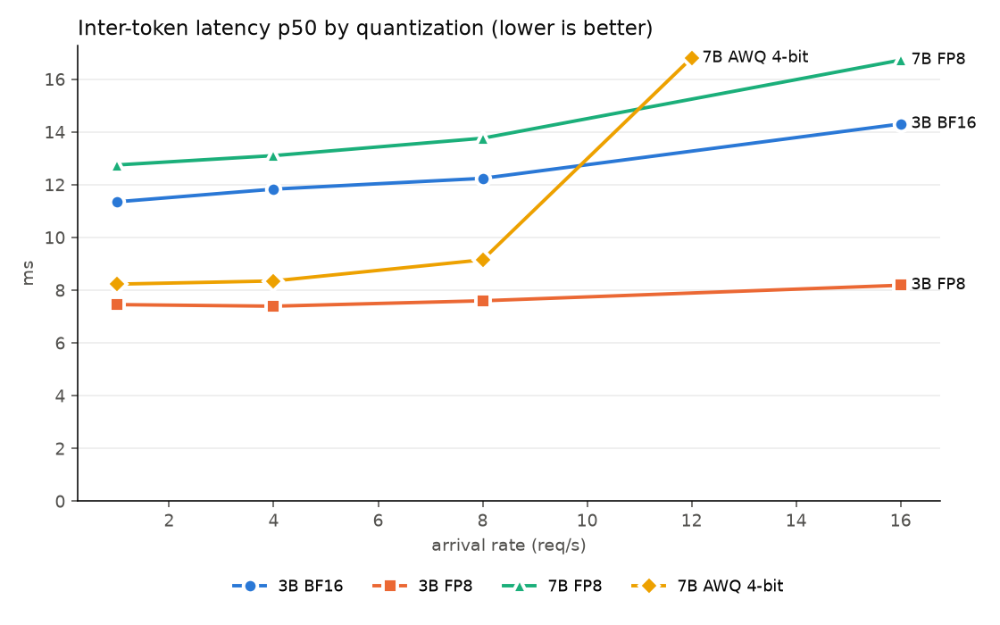
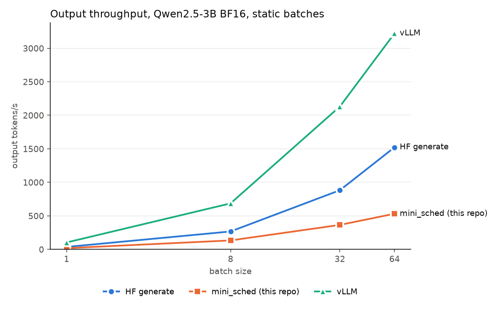
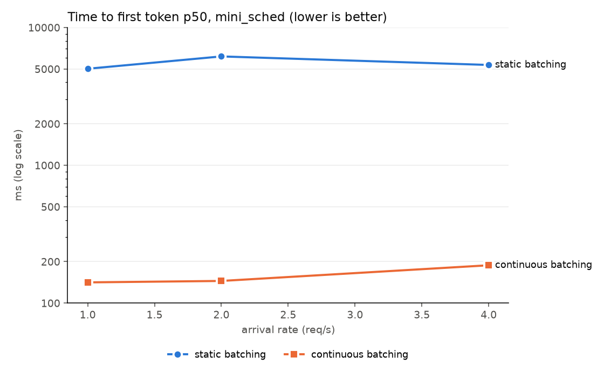
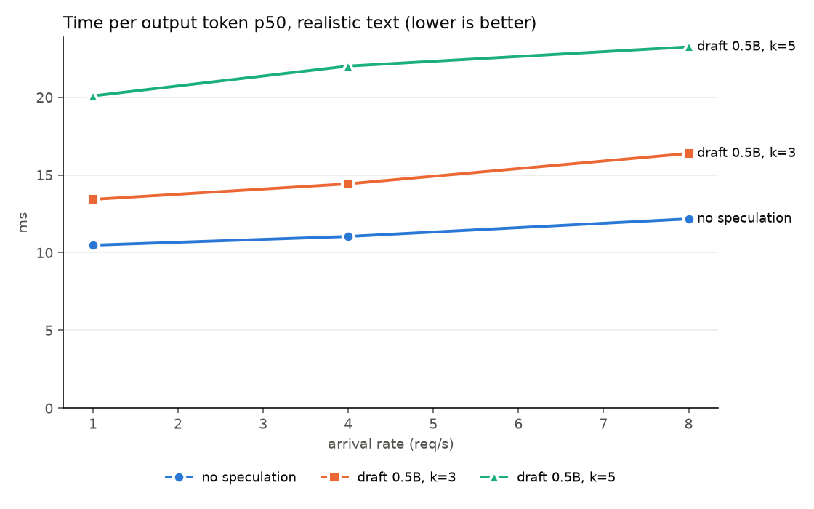

# Inference Lab

Benchmarking LLM serving on a single consumer GPU (RTX 5080, 16 GB, WSL2): how compilation, quantization, caching, batching
policy and speculative decoding change latency, throughput, memory and quality, measured with a harness that rejects runs
where the server degraded. Plus a small continuous-batching engine with a paged KV cache written from scratch (`mini_sched/`).

Every number below comes from `results/*.csv` or the server logs; `LAB_LOG.md` has the full record, including failed attempts,
refuted hypotheses and invalid runs.

## Results

### Compilation and CUDA graphs vs eager (Qwen2.5-3B BF16, 3 repeats each, LAB_LOG section 7)
| Rate (req/s) | ITL p50 eager / compiled (ms) | Speedup |
|---|---|---|
| 1 | 16.9 / 11.3 | 1.49x |
| 4 | 18.0 / 11.8 | 1.52x |
| 8 | 19.9 / 12.2 | 1.62x |
| 16 | 27.1 / 14.1 | 1.92x |
TTFT p50 is 28 to 35% lower with compilation.

### Quantization (vLLM, compiled; LAB_LOG sections 9 and 11)


| Model | ITL p50 at 1 / 4 / 8 / 16 req/s (ms) | Perplexity, WikiText-2 (81,880 tokens) |
|---|---|---|
| 3B BF16 (4 runs) | 11.3 / 11.8 / 12.2 / 14.3 | 7.9808 |
| 3B FP8 (3 runs) | 7.4 / 7.4 / 7.6 / 8.2 | 8.0540 (+0.92%) |
| 7B BF16 (eager, 6 GB CPU offload) | not a latency result | 6.8988 |
| 7B FP8 (3 runs) | 12.7 / 13.1 / 13.8 / 16.7 | 6.9494 (+0.73% vs 7B BF16) |
| 7B AWQ 4-bit (1 valid run) | 8.2 / 8.3 / 9.1 / 16.8 at 12 req/s | 7.2758 (+5.46% vs 7B BF16) |
Means of the valid runs in `results/main.csv` (`python plot.py --summary` prints them). Caveats: the 7B BF16 and AWQ perplexity
runs had INVALID latency canaries (perplexity itself is a fixed computation; LAB_LOG section 11); AWQ collapsed twice at 16 req/s
with default settings. Eager vs compiled numerics move perplexity by only 0.07% (3B control).

### Hugging Face `generate` vs vLLM vs this repo's engine (3B BF16, static batches, LAB_LOG sections 15 and 17)


| Batch | HF tok/s | vLLM tok/s | vLLM speedup | mini_sched tok/s |
|---|---|---|---|---|
| 1 | 35.6 | 102.4 | 2.87x | 17.5 |
| 8 | 266.3 | 685.3 | 2.57x | 132.6 |
| 32 | 881.5 | 2130.2 | 2.42x | 364.4 |
| 64 | 1522.0 | 3222.0 | 2.12x | 531.0 |
Medians of 6 (HF, vLLM) and 3 (mini_sched) trials; identical 256-token prompts, 128 greedy tokens. HF and vLLM produced the same
128 tokens. The gap is decode (TPOT 2.7x to 2.9x), not prefill (TTFT 1.05x to 1.43x).

### Continuous vs static batching in `mini_sched` (same model code, Poisson arrivals; LAB_LOG section 17)


| Rate (req/s) | TTFT p50 continuous / static (ms) | tok/s continuous / static |
|---|---|---|
| 1 | 141 / 5017 | 95.5 / 96.2 |
| 2 | 145 / 6164 | 215.0 / 178.4 |
| 4 | 188 / 5345 | 310.6 / 300.1 |
Paged KV used 12.0x to 12.8x fewer tokens of KV memory at peak than reserving 4,096 tokens per running sequence.
Greedy outputs match HF `generate` (differences only at exact logit ties), including under forced preemption.

### Speculative decoding (3B target, Qwen2.5-0.5B draft, realistic text; LAB_LOG section 14)


With this draft, speculative decoding is slower at every load: TPOT p50 +28.1% to +34.6% (k=3) and +90.9% to +99.2% (k=5), TTFT 2.4x to 4.1x worse,
and both configs collapse at 16 req/s where plain decoding delivers 2,103 tok/s. Draft acceptance on real text is 0.50 to 0.52 (k=3);
on the harness's random-word prompts it looked much higher (0.77 to 0.92 per position), which is why a realistic-text mode was added.

### Other findings
- **Prefix caching** (best case, ~1,540-token shared prefix): TTFT p50 31 / 35 / 38 ms vs 133 / 138 / 544 ms without, at 2 / 4 / 8 req/s
  (LAB_LOG section 10).
- **Chunked prefill** on vs off: no measurable difference with ~250-token prompts (3 interleaved pairs, LAB_LOG section 13).
- **Overload collapse (open problem):** under overload the server sometimes collapses (throughput down to 166 to 650 tok/s, ITL p50 141 to 799 ms)
  and stays slow until restarted. It happens with `--max-num-seqs` 256 and also 128 (1 of 2 runs), with KV usage at most ~40% and no
  preemptions. Ruled out so far: KV exhaustion, thermal throttling, WSL memory pressure, VRAM paging (LAB_LOG sections 5, 10, 12).
  Rate-32 numbers are not reproducible and are not used as results.
- **KV-cache formula** `2 x layers x kv_heads x head_dim x bytes` = 36,864 B/token predicts vLLM's reported capacity exactly (section 2).

## Method
- Open-loop Poisson arrivals, 30 s per rate (at least 100 requests), p50/p95/p99. Unique prompt prefix per request so the prefix
  cache cannot couple runs. Fixed output length, temperature 0, `--generation-config vllm`.
- **Fresh server per configuration and canaries:** a rate-1 run before and after each sweep; a run is INVALID if the after-canary
  ITL p50 exceeds 1.3x the before value. INVALID runs are reported as such, never averaged in (`results/runs.csv`).
- Comparisons are interleaved (A, B, A, B, ...) and repeated. Nothing else may use the GPU: Wallpaper Engine's video decode made
  fresh canaries ~23% slower (LAB_LOG section 12).
- `bench_modes.py` adds shared-prefix, closed-loop and realistic-text (WikiText-2 continuation) workloads.

## Environment
RTX 5080 (16 GB, sm_120), Windows + WSL2 (Ubuntu 22.04.5), driver 616.64, Python 3.12.15, vLLM 0.31.0, PyTorch 2.13.0+cu132.
Server flags: `--max-model-len 4096 --gpu-memory-utilization 0.85 --generation-config vllm --kernel_config.enable_jit_warmup=False`
(FlashInfer's JIT build fails here). The serve scripts strip `/mnt/` folders from PATH (torch inductor's nvcc lookup fails on WSL2).
TensorRT-LLM 1.2.1 installed but could not start its MPI worker on WSL2 (LAB_LOG section 16). Absolute numbers will differ on
native Linux; the comparisons are the point.

## Reproduce
```bash
MODEL=Qwen/Qwen2.5-3B-Instruct TAG=fp8-3b EXTRA="--quantization fp8" ./run_config.sh fp8-3b ./serve_generic.sh
```
`run_config.sh` starts a fresh server, runs the canaries and the sweep, writes the verdict to `results/runs.csv`, and stops the
server. Queue scripts (`queue_*.sh`) chain configurations. Other entry points: `ppl.py` (perplexity), `hf_vs_vllm.py` via
`run_hf_vs_vllm.sh`, `python -m mini_sched.test_mini`, `python -m mini_sched.bench_sched`, `python plot.py --summary`.

## Files
| Path | Purpose |
|---|---|
| `bench.py`, `bench_modes.py` | Load generators (Poisson; shared-prefix, closed-loop, realistic text) |
| `run_config.sh`, `serve_*.sh`, `queue_*.sh` | Fresh-server runner with canaries, server launch, experiment queues |
| `ppl.py` | WikiText-2 perplexity through the server |
| `hf_vs_vllm.py`, `run_hf_vs_vllm.sh`, `run_trtllm.sh` | In-process engine comparison |
| `mini_sched/` | Paged KV cache + continuous-batching engine (see its README) |
| `plot.py` | Sweep plots and the summary figures above |
| `results/` | Raw CSVs, server logs, figures |
| `LAB_LOG.md` | Full experiment log |
